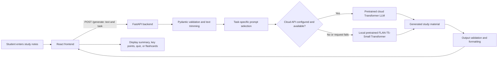

# Smart Notes Condenser — Project Report

## 1. Project Title

**Smart Notes Condenser: AI-Based Study Material Generator Using Transformer NLP**

## 2. Abstract

Smart Notes Condenser is a full-stack educational NLP application that converts unstructured student notes into useful revision material. Students often spend considerable time manually turning lecture notes, textbook excerpts, and transcripts into summaries, important points, questions, and flashcards. This project automates that preparation process through a simple web interface. A user enters notes, selects an output type, and receives an AI-generated result. The available output types are an abstractive summary, numbered key points, a self-test quiz with answers, and active-recall flashcards.

The frontend is built with React, Vite, Tailwind CSS, and Axios, while the backend uses FastAPI and Pydantic. The application performs inference with pretrained Transformer language models; it does not train a neural network or create an LLM from scratch. When an API key is configured, the backend first requests generation from a cloud language-model API. If that is unavailable or fails, it falls back to the locally loaded FLAN-T5-Small encoder-decoder Transformer through PyTorch and Hugging Face Transformers. The result is a practical, student-friendly tool for producing revision aids from source notes.

## 3. Introduction

Study material is often lengthy, unstructured, and difficult to revise quickly. Learners may understand a topic better through a concise overview, a list of core facts, practice questions, or flashcards. Creating each of these manually is repetitive and time-consuming.

Smart Notes Condenser addresses this by generating several study formats from the same notes. Rather than offering age-based explanation levels, the implemented project offers four **study-output formats**: Summary, Key Points, Quiz, and Flashcards. This supports different revision activities: quick understanding, recall of essentials, self-testing, and active recall.

## 4. Problem Statement

Students need to transform large or unstructured notes into revision-friendly material, but manual summarisation and question creation require significant time. A system is needed that accepts source notes and generates structured study resources while preserving the main concepts from the input.

## 5. Objectives

- Build an easy-to-use web application for processing study notes.
- Generate four revision formats: summary, key points, quiz, and flashcards.
- Demonstrate practical NLP and Transformer-model inference.
- Use prompt-based generation with pretrained language models rather than training a new model.
- Validate input and present helpful errors to users.
- Provide a local FLAN-T5-Small fallback when the configured cloud service is unavailable.

## 6. Scope of the Project

The system accepts plain-text study notes of up to 20,000 characters and returns one selected output type per request. It is designed for subjects such as biology, computer science, physics, history, and similar text-based learning material. It has no authentication, database, document upload, stored user history, multilingual interface, or factual-verification system. It does not support Age 10, High School, College, or Expert explanation levels; that capability is not present in the frontend or backend.

## 7. Technology Stack

| Area | Technologies used in the code |
|---|---|
| Frontend | React 19, Vite, Tailwind CSS, Axios |
| Backend | Python, FastAPI, Uvicorn |
| AI/ML | Pretrained cloud language models when configured; local `google/flan-t5-small`, PyTorch, Hugging Face Transformers, SentencePiece |
| Validation | Pydantic request schema, `Literal` task values, client-side checks |
| Reliability and access control | Configurable CORS allow-list, friendly HTTP errors, Axios request timeout |

## 8. System Architecture



At application startup, `main.py` loads the local FLAN-T5-Small model once. `services.py` chooses the cloud route first only when its API key is available; otherwise it uses the local model. The response includes the engine name so the interface can display which engine generated the result.

## 9. NLP and AI/ML Concepts Used

- **Natural Language Processing (NLP):** NLP enables computers to process and generate human language. Here it transforms source notes into study material.
- **Abstractive summarisation:** A summary may use new wording instead of only copying sentences from the notes. This is the project’s Summary task.
- **Information extraction and structuring:** Key Points, Quiz, and Flashcards organise useful facts into a revision-friendly form.
- **Natural Language Generation (NLG):** The model produces human-readable text, questions, answers, and definitions from the prompt and notes.
- **Tokenization:** A tokenizer converts text into numerical token IDs before a local model processes it, and converts generated IDs back to text afterward.
- **Word embeddings:** Transformer models internally represent tokens as learned numeric vectors, called embeddings, so related words and context can be processed mathematically.
- **Transformer architecture:** Transformers use layers that learn relationships across a sequence of tokens. The local FLAN-T5 model is a Transformer.
- **Attention mechanism:** Attention helps a Transformer assign importance to relevant tokens in the input when interpreting or generating text.
- **Encoder-decoder concept:** FLAN-T5 has an encoder that reads the prompted notes and a decoder that generates output tokens one at a time.
- **Pretrained model:** Both possible engines use models already trained before this project. Their learned parameters are reused here.
- **Inference:** Inference is using learned weights to generate a response for new input. The local code uses `model.eval()`, `torch.no_grad()`, and `model.generate()`; it does not update weights.
- **Prompt engineering:** Task-specific instructions define the required output format. For example, quiz prompts request `Q1`/`A1` pairs and flashcard prompts request `Front`/`Back` pairs. The cloud path also varies quiz and flashcard focus angles.
- **Training versus pretrained-model use:** Training would require data, loss calculation, backpropagation, and weight updates. This project performs no such training or fine-tuning. It only sends prompts to pretrained models and receives generated text.

## 10. Working Methodology

1. The student enters or loads sample study notes in the React interface.
2. The student selects Summary, Key Points, Quiz, or Flashcards.
3. The frontend checks for empty or over-limit input and sends `text` and `task` to `POST /generate`.
4. Pydantic trims the text, rejects empty text, restricts input to 20,000 characters, and accepts only the four allowed task names.
5. The backend selects an appropriate prompt strategy.
6. If configured, it requests output from a pretrained cloud language model. If not available or unsuccessful, it runs the local pretrained FLAN-T5-Small model.
7. Local generation uses task-specific processing: two focused calls for summaries, sentence sections for key points, and repeated prompted calls for quiz and flashcard items.
8. The backend cleans and validates output, then returns the result and engine name.
9. The frontend renders the result. Quiz answers can be revealed individually, and flashcards can be flipped.

## 11. Study Output Types

| Output type | Purpose | Typical format | Interface behaviour |
|---|---|---|---|
| Summary | Give a concise overview | One or more explanatory paragraphs | Paragraph cards |
| Key Points | Highlight essential facts | Up to five numbered points | Numbered cards |
| Quiz | Support self-testing | Question-and-answer pairs | Answers are initially hidden and can be revealed |
| Flashcards | Support active recall | Front/back concept cards | Cards flip between prompt and answer |

## 12. Key Features

- Large text input with live word and character counters.
- Selection of four study-material outputs.
- Two built-in sample note sets: Photosynthesis and Binary Search.
- Clear button to reset the notes, result, engine label, and error state.
- Loading indicator while a request is running.
- One-click copy of generated output to the clipboard.
- Responsive React/Tailwind interface.
- Client-side and server-side input validation.
- Interactive quiz answer reveal and flashcard flip behaviour.
- Cloud-first generation with automatic local FLAN-T5 fallback.

## 13. Example Input and Output

**Input:** “Binary search finds a target in a sorted array by repeatedly comparing it with the middle element and discarding half of the remaining search space.”

**Possible summary output:** “Binary search is a fast method for finding a value in a sorted array. It compares the target with the middle element and keeps only the half that could still contain the target.”

**Possible flashcard output:**

```text
Front: Why is binary search efficient?
Back: Each comparison removes half of the remaining sorted search space, so its time complexity is O(log n).
```

These examples illustrate the project’s actual output formats. It does not generate separate Age 10 or College explanations.

## 14. Security and Reliability

The project provides useful baseline safeguards, but its code should not be described as implementing every production security control.

- **Input limits:** both frontend and Pydantic backend enforce a 20,000-character maximum.
- **Invalid-request rejection:** the API accepts only the four explicitly defined task values and rejects empty text.
- **Safe error handling:** backend exceptions are logged internally but clients receive friendly HTTP error messages rather than raw stack traces.
- **CORS restriction:** allowed origins come from `ALLOWED_ORIGINS`, with local Vite URLs as the default.
- **Request timeout:** Axios is configured with a 300,000 ms timeout and the UI explains connection and timeout failures.
- **Output checks:** the service rejects empty, placeholder-like, or too-short generated results.

The current code does **not** implement rate limiting or dedicated security-header middleware. Those should be treated as future hardening work, not existing features.

## 15. Limitations

- The cloud-first route depends on an API key and internet connection; cloud responses also vary by selected available model.
- The local fallback depends on the downloaded pretrained FLAN-T5-Small model and is slower than a cloud service on typical CPU hardware.
- Generative models can vary in wording and can produce incomplete or factually inaccurate content.
- Long local prompts are tokenized with a 512-token maximum, so some input may be truncated before local inference.
- No conversation context, database, or saved history is implemented.
- The system is limited to plain-text notes and does not validate source facts against external references.

## 16. Future Enhancements

- Add multilingual note processing and user-interface support.
- Add speech-to-text input and text-to-speech output.
- Show a readability score for generated content.
- Generate quizzes with difficulty settings and score tracking.
- Add optional user accounts and chat/history memory.
- Add citation-aware factual verification against trusted learning sources.
- Support PDF, DOCX, PPTX, and OCR-based note input.
- Optionally fine-tune a future model on high-quality note-to-summary, question, and flashcard pairs, with an appropriate dataset and evaluation process.
- Add rate limiting, security headers, authentication, and server-side API-call timeouts for stronger deployment security.

## 17. Conclusion

Smart Notes Condenser is an NLP-based educational web application that converts student notes into summaries, key points, quizzes, and flashcards. It integrates pretrained Transformer language models for inference and does not train a neural network from scratch. Its React frontend, FastAPI backend, prompt-based task handling, validation, and local FLAN-T5-Small fallback demonstrate a practical use of AI/ML and NLP for student revision.

## 18. Viva Questions and Answers

1. **What is NLP?**  
   NLP is the field of AI that helps computers understand, process, and generate human language.

2. **Why is this an AI project?**  
   It uses pretrained Transformer language models to generate study material from natural-language notes.

3. **What is a pretrained model?**  
   It is a model that was already trained on large datasets before being used in this application.

4. **Did you train the model?**  
   No. The project only performs inference with pretrained models; it does not train or fine-tune them.

5. **What is inference?**  
   Inference is using a trained model’s existing weights to make an output for new input.

6. **What is prompt engineering?**  
   It is writing clear instructions that guide the model toward a required task and output format.

7. **What is tokenization?**  
   It is the conversion of text into numerical tokens that a model can process.

8. **Why use Transformer models?**  
   Transformers use attention to model relationships between words across a text and are effective for language generation.

9. **What is the role of FLAN-T5-Small in this project?**  
   It is the local pretrained encoder-decoder Transformer fallback used for generation.

10. **What is the role of the cloud LLM route?**  
   When configured, it is the primary generation engine; the local model is used if it is unavailable or fails.

11. **What outputs can the user select?**  
   Summary, Key Points, Quiz, and Flashcards.

12. **How is input validated?**  
   The frontend checks it first, and Pydantic rejects empty text, text over 20,000 characters, and unsupported task values.

13. **What is the difference between an RNN and a Transformer?**  
   An RNN processes text mainly step by step, while a Transformer uses attention to relate tokens across the sequence more directly and with greater parallelism during training.

14. **What are the limitations of the project?**  
   It can depend on internet/API availability, outputs can vary or contain inaccuracies, local input is token-limited, and there is no stored context or factual verification.

15. **Does the project simplify text by Age 10, High School, College, and Expert levels?**  
   No. That feature is not implemented. The project instead generates four revision formats from student notes.

## Code-Accuracy Notes

The inspected workspace contains `backend/app/services.py` and `backend/app/llm_client.py`, rather than the requested `routes.py`, `ai_service.py`, `utils.py`, or `config.py`. No root-level `requirements.txt`, `run.sh`, or `report.txt` was present; the dependency list is `backend/requirements.txt`. Unlike an unused alternative, `backend/app/model.py` is imported by the active app, loaded at startup, and used as the local fallback implementation.
